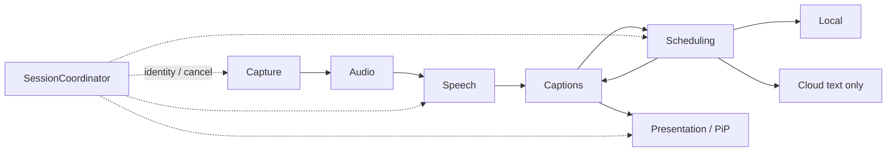

# 框架与公共契约

依据正式方案 §§3、5–13。当前只含静态 App 空壳、值类型、协议与参数，不含下列模块的实现。

## 目录和所有者

| 目录 | 职责 | 后续任务 |
| --- | --- | --- |
| `LiveSubtitle/App` | 入口、依赖装配、生命周期 | 集成人 / TASK-13 |
| `LiveSubtitle/Contracts` | 值类型、协议、RuntimePolicy | 集成人 |
| `LiveSubtitle/Session` | 状态、身份代次、幂等停止 | TASK-03 |
| `LiveSubtitle/Capture`、`Audio` | 系统全屏采音、自有 PCM、转换及有界输入 | TASK-04 |
| `LiveSubtitle/Speech` | 能力、资源、识别和 UI 资源准备桥接 | TASK-05 |
| `LiveSubtitle/Captions` | 转写归一化、分段、最近段存储 | TASK-06 |
| `LiveSubtitle/Translation/Local` | 已安装资源的本地翻译 | TASK-07 |
| `LiveSubtitle/Translation/Cloud` | 兼容接口、SSE、固定短句测试 | TASK-08 |
| `LiveSubtitle/Storage` | 非秘密偏好、profile 和 Keychain | TASK-09 |
| `LiveSubtitle/Translation/Scheduling` | 有界调度、修订预算、取消及回退请求 | TASK-10 |
| `LiveSubtitle/Presentation` | 布局、像素帧、PiP、恢复事件 | TASK-11 |
| `LiveSubtitle/Features` | 设置、下载状态、主页面 | TASK-12 |
| `LiveSubtitle/Diagnostics` | 无内容指标 | TASK-13 |
| `LiveSubtitle/Validation/G0` | 临时真机链路验证，仅 G0 使用 | TASK-02，TASK-13 清理 |
| `LiveSubtitleTests/<模块>` | 对应所有者的独立测试 | 与实现同属一个任务 |

## 数据边界

- 契约实际签名以 `Contracts/Ports/*.swift` 为准，任务卡只给类型名称和消费关系，避免文档复制后漂移。
- `AudioTimestamp` 保留有理数媒体时间，`MonotonicInstant` 只表示主机 uptime。适配层负责 PTS→单调时间映射；不得直接比较两类裸数。
- `MonotonicClock.sleep(until:)` 必须响应取消；测试时钟推进到截止点时唤醒等待者，不需要真实等待三秒／六秒。
- `PCMFormat` 描述位宽、交错、字节序和每帧字节；`ownedPCM` 是平面数组。非交错按声道分平面，生产者在跨域前取得数据所有权。`AudioFormat` 是识别器查询后交给转换器的目标格式。
- `TranscriptSpan.characterRange` 以当前事件 text 的用户可见字符为单位；音频范围来自 SDK。缺少可用时序映射的识别路径在窗口上限处显式重建，不无限存完整转写。
- `TranslationUpdate.text` 是当前作业的累计替换文本。云适配器负责合并 SSE 增量，消费者不能再次追加导致重复。
- `CaptionSegmenting.start(input:)` 输出独立流，分段器可在没有下一次识别回调时通过注入时钟发出暂停分界或 provisional 段；reset 同时取消输入消费、计时和输出，不依赖再来一次回调才触发截止。
- AI 调度启动及显式恢复通过 `start`／`setMode` 传入当前 SessionConfig 和不可变 CloudProfile，创建 job 时固定非秘密快照；profile ID 必须与所选配置匹配、revision 必须与 identity.cloudConfigRevision 匹配。setMode更新配置快照以支持会话中选择新profile，但不能藉此更换语言对（换语言须新会话）。Cloud 只用 job.cloudProfile 的 endpoint／model 和该ID的Key，不在发送时读取可变的全局所选profile；本地job的cloudProfile为nil。
- `SchedulingEvent.translation(job:update:)` 随结果带原始作业，存储通过 `apply(_:for:now:)` 检查 deadline 及请求关联。作业失败／超时产生副作用前由调度器检查归属；当前有效 timeout 不能先被 deadline 丢弃。
- `fallbackRequested` 仅是兼容性提示，不直接引发回退；协调器以携带原始 job 的 `failed` 重新校验完整代次、保留段和修订版本后，才增加 engineEpoch，调用调度器 `setMode` 和存储 `advanceIdentity`。失败待确认期间只退休故障作业，保留其余作业和原截止时间，并暂停新派发；每个仍有效 deadline 仍须单独发出故障。消费者拒收旧故障时调用 `discardFailure(for:)`，按完整 identity/jobID/segmentID/sourceRevision 解除对应暂停；不能重置修订预算或解除另一项待确认故障。修订、淘汰、停止与换代同步清理对应项。
- `CaptionStoring.snapshot` 包括所有保留段（最多十段）；renderer 按 displayCount 和实际尺寸决定可见部分。段淘汰时协调器把当前保留 ID 交给调度器 `retainOnly` 同步清引用。
- `LanguageAssetManaging` 在 MainActor，为 Translation 的前台下载 UI 保留桥接空间；TASK-05 交付可供 TASK-12 嵌入的 `LanguagePreparationHost`，不把非 Sendable TranslationSession 放进公共模型。TASK-07 仅使用已安装资源创建非 UI 会话。
- profile 的 revision 由 `PreferencesStoring.saveProfile` 实现按已存版本单调递增；UI 保存后重新读取已保存 profile，不自行再次递增。运行中编辑profile、选中不同profile、替换／删除Key，必须先 await `cloudProfileWillChange` 关闭AI入口、失效旧代次并等待取消，再写存储；之后调用 `cloudProfileDidChange` 重读新配置，保持本地，等用户显式恢复。Key变更也要保存新profile revision。

## 流与生命周期

所有流都属于启动它的本次会话，但身份检查必须匹配事件的作用域：

| 事件 | 接受前检查 |
| --- | --- |
| Capture、Audio、Speech、Segmenter的数据和终止／错误 | 会话有效、sessionID和languageEpoch相同；翻译engineEpoch改变不使这些流失效 |
| PiP事件 | 会话有效、sessionID相同，以及恢复界面过程状态 |
| 翻译结果、翻译失败／丢弃、回退请求 | 会话有效、完整identity；job事件还检查segment仍保留、sourceRevision及jobID；成功另外检查deadline |
| 连接测试 | 本次测试令牌、完整identity及profileID／revision仍匹配；启动前测试用独立准备代次 |
| 语言资源准备 | 本次准备代次／所选语言仍匹配，取消后的旧完成不启动采集 |

协调器在消费者端重新验证事件，即使生产者在入队前校验过也不能省略。`SchedulingEvent.failed`／`dropped` 都携原始job，不能让缓冲中的旧故障停止新模式；没有job的启动／配置错误由 `start`／`setMode` 抛出，调用者按调用归属处理。有效timeout检查任务仍有效后触发一次，不按已过deadline丢弃。

`Translator` 每作业一个流；末次成功为 isFinal，失败用 failure，随后结束。消费者提前退出必须取消生产，主动取消用结束／CancellationError 表达，不伪造服务故障。切模式只变翻译代次，不能重启采集／连续识别或静默丢弃其后续数据。

`AudioSource.start` 的用户取消在 TASK-04 定义为 `CancellationError`；仅在采集尚未启动时视为选择器取消并回到 ready。采集启动后其他组件的 CancellationError 必须按对应阶段清理已启动组件，不能冒充用户取消。其他可恢复／终止错误使用 `FailureCode`。无正文 Error 透传至日志或 UI。

控制事件的可靠传达与高频数据的有界策略由实现负责。音频流结束、采集撤销、Speech 失败不能因 drop-oldest 丢失；允许内部使用单独控制通道，公共输出仍遵守终止语义。

## 构建与测试

原生文件系统同步组分别绑定 App 和 Tests，新增 Swift 文件自动编译。纯逻辑测试通过 `@testable import LiveSubtitle` 使用同一份模型；测试 host 是空壳 App，不做 UI 自动化。当前 `Scaffold.swift` 只有导入，无伪造的通过用例。

不引入额外 Package。需要新的跨模块类型时，先由集成人提交 Contracts 变更；新增模块内部私有类型由任务 owner 自行决定。

## 2026-11-05 集成续修说明

用户在 TASK-14 对话明确授权“授权集成修复并继续验收”，允许该分支承担集成人职责，修改必要生产模块及公共契约；不改变产品范围。新增 CaptionStoring.remove(segmentID:)（已提交）及 TranslationScheduling.discardFailure(for:)，同步更新消费者和测试 double。

PiP 新会话先挂载显示层并入队真实内存首帧，再按 RuntimePolicy 的有界 readiness 期限等待；每轮先检查取消和截止，再接受可用状态。启动请求返回不代表小窗已显示，实际 started/failed 回调仍必须消费。播放音频会话只配置 playback/moviePlayback/mixWithOthers，不播放静音，不启用麦克风；由捕获生命周期按 session 所有者配对释放。

无正文诊断共用每轮随机编号与有界环，RSS/热状态按 RuntimePolicy.resourceSamplingInterval 采样，队列指标同步写入 recorder，不为每项创建无结构 Task。Debug 显式 --validation-metrics 才开启控制台出口，Release 无此出口；这组计数不等于端到端延迟。

初始采集成功回调可能早于共享面板消失。LifecycleAudioSource 等用户返回 active 后才把流交回启动流程，等待可取消；PiP readiness 三秒从其后开始。适配器 possible 只读取 AVKit 系统值，避免将初次共享面板限制施加于后台恢复。前台轮询参数来自 RuntimePolicy.captureForegroundPollInterval（50 ms）。
