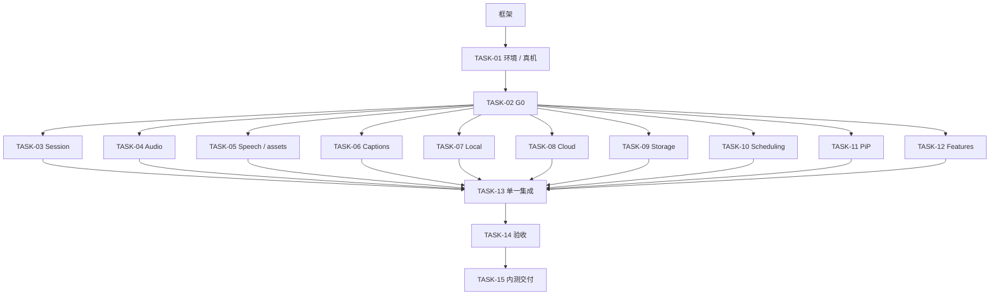

# 多 agent 开发任务

本次仅搭框架，下面任务均未执行。先读 [正式方案](../development-spec.md)、[项目约束](../project-constraints.md)、[模块契约](../architecture.md)。任务卡的路径以仓库根目录为基准。

## 分配表

| 任务 | 产物 | 开始条件 | 独占目录 |
| --- | --- | --- | --- |
| [TASK-01](TASK-01-platform.md) | 签名、设备和环境基线 | 框架已合入 | platform 报告 |
| [TASK-02](TASK-02-g0.md) | 十五分钟真实完整链路 G0 | TASK-01 真机可用 | Validation/G0、g0 报告 |
| [TASK-03](TASK-03-session.md) | 状态机、身份、幂等停止 | G0 通过 | Session |
| [TASK-04](TASK-04-audio.md) | 采音、格式转换、有界音频 | G0 通过 | Capture、Audio |
| [TASK-05](TASK-05-speech-assets.md) | 能力、资源、连续识别 | G0 通过 | Speech |
| [TASK-06](TASK-06-captions.md) | 转写窗口、分段、存储 | G0 通过 | Captions |
| [TASK-07](TASK-07-local.md) | 本地翻译适配 | G0 通过 | Translation/Local |
| [TASK-08](TASK-08-cloud.md) | BYOK、SSE、连接测试 | G0 通过 | Translation/Cloud |
| [TASK-09](TASK-09-storage.md) | 偏好、profile、Keychain | G0 通过 | Storage |
| [TASK-10](TASK-10-scheduling.md) | 队列、预算、回退请求 | G0 通过 | Translation/Scheduling |
| [TASK-11](TASK-11-presentation.md) | 帧、布局、PiP | G0 通过 | Presentation |
| [TASK-12](TASK-12-features.md) | 主界面、三类设置 | G0 通过 | Features |
| [TASK-13](TASK-13-integration.md) | 装配、系统事件、诊断 | TASK-03～12 已验证合入 | App、Diagnostics、共享文件 |
| [TASK-14](TASK-14-validation.md) | A01–A24、30分钟、P95 | TASK-13 | 验收与性能报告 |
| [TASK-15](TASK-15-beta.md) | 内测安装与交接 | TASK-14 | 内测交付文档 |

任务同时拥有对应测试子目录，准确路径见任务卡。TASK-07、08、10 的测试分别在 Translation/Local、Cloud、Scheduling，避免重叠。

## 顺序和可并行关系



“独立开发”指可在固定 Ports、自己的 doubles 和自己的目录中完成、编译、测试和提交。真实端到端验收仍需其他实现及设备，不能因为独立测试通过就把整个功能写成可用。

G0 前只做环境与完整链路验证，不提前大规模扩展正式模块。G0 通过后集成人先发布固定契约 commit，各任务从这个相同基线开始；如果 G0 改变了平台假设，先统一修订 Contracts 和任务卡。

资源较少时建议四个槽位分批：03/04/05/06 → 07/08/09/11 → 10/12 → 13。顺序只是排期建议，10/12 可以更早独立用 doubles 开发。合并建议 09→04→05→06→07→08→10→11→03→12，每次运行框架检查和当前全量行为测试，再执行13装配。

## 避免冲突

1. 每个 agent 一个 worktree、分支和任务。不要让 Codex 和 Claude Code 同时操作一个目录的 Git 索引。
2. `Contracts`、`Config`、`App`、工程、scheme、scripts、根入口及任务总表是集成人所有。模块任务新增 Swift 文件无需改 pbxproj；`.gitkeep` 已排除构建。
3. task owner 不直接改总表上的状态，提交自己的交接文件。集成人合并时统一更新总表，避免每个任务都争抢 README。
4. 不抢写其他任务的具体实现。需要共享接口变更时，在交接提出旧签名、新签名、原因、消费者和测试影响；由集成人先单独提交契约变更。
5. 暂时缺失实现使用任务内测试 double，不在生产路径创建“成功”占位，不引入另一份业务模型。
6. 同步采用 merge 或 rebase 后重新测试；不 force push main、不用 reset／clean 覆盖其他人的工作。push／合并由负责人分配权限执行。

## 启动方式

负责人可在仓库根目录建立独立目录，例如：

```bash
git fetch origin
git worktree add .worktrees/task-06 -b feat/task-06-captions origin/main
```

在这个 worktree 内启动 Codex 或 Claude Code，给它以下提示（替换任务与基线）：

```text
只实现 docs/tasks/TASK-06-captions.md。
基线 commit：<统一契约 commit>。前置 G0 报告：<已通过的报告路径>。
先读 AGENTS.md、docs/project-constraints.md、docs/architecture.md 和任务卡。
只修改任务卡文件所有权范围，公共接口有缺口先提出变更，不代写别的模块。
业务先写失败测试再实现；运行当前全量测试和 scripts/verify.sh。
独立提交，并按 docs/tasks/HANDOFF.md 交接；不要合并或推送 main。
```

Claude Code 会通过 CLAUDE.md 导入同一份约束。不要把完整 API Key 或真实字幕贴进启动提示。

## 原方案覆盖与重点检查

| 原方案 | 新任务 |
| --- | --- |
| T01 / T02 | TASK-01 / TASK-02 |
| T03 | TASK-03 |
| T04 | TASK-05、TASK-12 |
| T05 | TASK-04、TASK-05、TASK-06、TASK-10 |
| T06 | TASK-07、TASK-11、TASK-12、TASK-13 |
| T07 | TASK-08、TASK-09、TASK-12 |
| T08 | TASK-03、TASK-10、TASK-13 |
| T09 / T10 | TASK-14 / TASK-15 |

五类跨模块风险分别由任务验收钉住：旧回调和有效超时（03/06/10）、十分钟无 final 有界内存（05/06）、UTF-8 分块和有界输出（08）、PiP 关闭与恢复及旧对象（03/11）、配置变更和本地模式数据边界（09/12/13）。全体真实场景最后按 A01–A24 验证。
